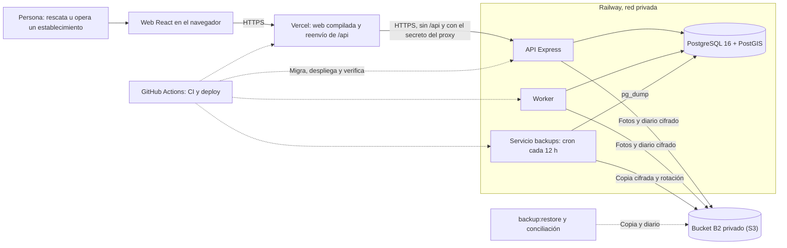
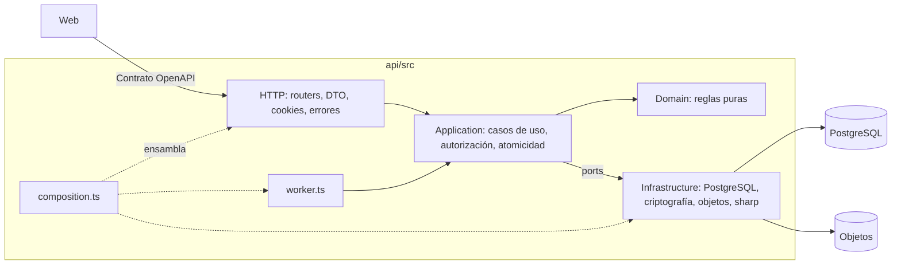
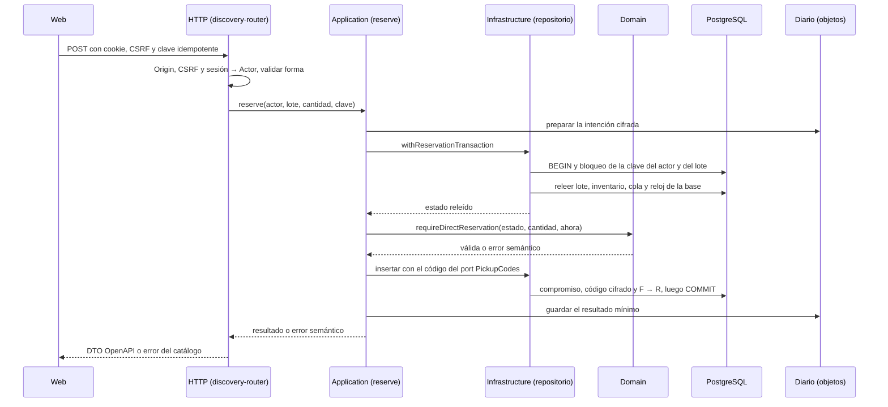
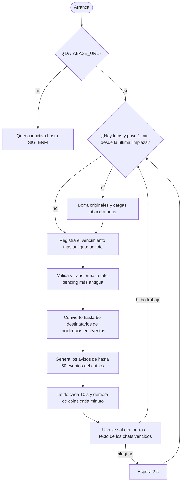

# Arquitectura de Rescate

Rescate es un monolito modular: una web React, una API Express y un worker que
comparten el mismo backend, PostgreSQL/PostGIS como única fuente de verdad y un
almacenamiento de objetos privado para las fotos, las copias y el diario de
recuperación. La decisión está en
[ADR 0003](../adr/0003-arquitectura-incremental-s02.md); E1 (informe pp. 3–4) ya
proponía monolito modular, PostGIS, objetos y un trabajador con reglas compartidas.

No hay microservicios, broker, Redis, event bus, ORM, framework de repositorios ni
contenedor de inyección. Los trabajos asíncronos viven en tablas PostgreSQL que el
worker reclama.

## Sistema en producción

| Componente | Qué hace | Detalle |
| --- | --- | --- |
| Web | Interfaz por rol: búsqueda, reserva, espera, chat, avisos e incidencias de quien rescata; lotes, retiros, panel e incidencias del operador. Tipos HTTP generados desde OpenAPI. | [web/README](../../web/README.md), [manual](../manual.md) |
| Vercel | Sirve `dist/` y reenvía `/api/*` al origen HTTPS de la API quitando el prefijo. Agrega `x-rescate-proxy-secret`, con el que la API acepta la IP del cliente que fija Vercel. Las cookies son del dominio de la web. | [despliegue](../despliegue.md), [seguridad](../seguridad.md) |
| API | 44 operaciones HTTP de [OpenAPI](../api/openapi.yaml) y `GET /health`. Sesión por cookie, Origin/CSRF en comandos y límites por usuario y por IP del cliente. | [seguridad](../seguridad.md), [identidad](../k008-identidad.md) |
| Worker | Mismo paquete e imagen que la API (`node dist/worker.js`), otro proceso, sin HTTP y con un Pool de 2 conexiones. | [Worker](#worker) |
| PostgreSQL/PostGIS | Datos, inventario, colas de trabajo (fotos, vencimientos, outbox, destinatarios de incidencias) y latido del worker. Sin acceso público. | [modelo de datos](../modelo-inicial.md), [migraciones](../migraciones.md) |
| Objetos | Bucket B2 privado: fotos, copias cifradas (`rescate-backups/v1/`) y diario de recuperación. En desarrollo, un directorio local. La web nunca recibe una URL del bucket: la API sirve los bytes. | [fotos](../fotos.md) |
| CI/CD | [ci.yml](../../.github/workflows/ci.yml) valida tipos, lint, pruebas, build y Compose con PostGIS, worker y Chromium HTTPS. [deploy.yml](../../.github/workflows/deploy.yml) migra, despliega API y luego worker y web en paralelo, publica el servicio backups con el mismo commit y verifica el sitio ([ADR 0015](../adr/0015-deploy-de-worker-y-web-en-paralelo.md)). | [desarrollo local y CI](../desarrollo-local.md) |
| Backups | Servicio Railway con [Dockerfile.backup](../../api/Dockerfile.backup) que se ejecuta cada 12 h: copia PostgreSQL y las fotos listas con manifiesto, cifra con AES-256-GCM, verifica lo subido y conserva la última copia de cada uno de los siete días. La restauración concilia base y fotos. | [operación](../operacion.md#programación-y-secretos) |
| Diario de recuperación | Registro cifrado fuera de PostgreSQL de cada comando que cambia compromisos, para identificar los posteriores a una copia antes de reabrir. | [ADR 0022](../adr/0022-diario-de-recuperacion.md), [operación](../operacion.md#compromisos-posteriores-a-la-copia) |

En desarrollo, [Compose](../../compose.yaml) levanta web (Vite), API, worker y
PostGIS con fotos en un volumen local. Vite reenvía `/api` igual que Vercel. Ni la
API ni Compose migran al arrancar: en producción migra el pre-deploy de la API.

## Módulos

Los módulos agrupan capacidades del negocio; cada uno atraviesa las cuatro
responsabilidades técnicas con archivos propios en `http/`, `application/<módulo>/`,
`domain/` e `infrastructure/postgres/`.

| Módulo | RF | Router HTTP | Documento |
| --- | --- | --- | --- |
| Identidad y consentimiento | RF01 | `auth-router` | [identidad](../k008-identidad.md) |
| Establecimientos operables | RF01, RF02 | `establishments-router` | [identidad](../k008-identidad.md), [lotes](../lotes.md) |
| Lotes y gestión posterior | RF02 | `lots-router`, `lot-management-router` | [lotes](../lotes.md) |
| Fotos | RF02 | `photos-router` | [fotos](../fotos.md) |
| Descubrimiento y reserva directa | RF03, RF04 | `discovery-router` | [lotes](../lotes.md#búsqueda-y-reserva-directa) |
| Reservas, cancelación y retiro | RF05, RF06 | `reservations-router` | [reservas](../reservas.md) |
| Cola de espera y ofertas | RF07 | `waitlist-router` | [cola de espera](../cola-de-espera.md) |
| Vencimientos | RF08 | — (worker) | [vencimientos](../vencimientos.md) |
| Avisos internos | RF09 | `notifications-router` | [avisos](../avisos.md) |
| Panel y resultados | RF10, RF12 | `panel-router` | [panel](../panel.md) |
| Incidencias | RF11 | `incidents-router` | [incidencias](../incidencias.md) |
| Chat de la reserva | RF13 | `chat-router` | [chat](../chat.md) |
| Operación y recuperación | RNF04, RNF08 | `/health` | [operación](../operacion.md), [ADR 0022](../adr/0022-diario-de-recuperacion.md) |

La sesión trae hasta veinte establecimientos del usuario para orientar la interfaz;
el resto se busca por nombre o dirección en páginas de veinte. Esa lista no concede
permisos: cada comando vuelve a comprobar la membresía.

## Responsabilidades del backend

La flecha Application → Infrastructure es una llamada a un port inyectado, no un
import del adaptador concreto. API y worker crean sus propias instancias de los
casos de uso: comparten código, no memoria.

| Responsabilidad | Hace y puede conocer | No hace ni conoce |
| --- | --- | --- |
| **HTTP** ([http/](../../api/src/http)) | Rutas, middleware, validación estructural, cookies, IP del cliente detrás del proxy, DTO generados y traducción de resultados y errores. Conoce Express y Application. | SQL, pg, SDK de objetos ni reglas del negocio. |
| **Application** ([application/](../../api/src/application)) | Casos de uso, autorización con el actor autenticado, coordinación y definición de la unidad atómica. Define sus ports. | `req`/`res`, cookies, códigos HTTP, `pg.Pool`, SDK S3 ni adaptadores concretos. |
| **Domain** ([domain/](../../api/src/domain)) | Invariantes y decisiones puras: transiciones, inventario, plazos, cupos y límites. Recibe el instante como valor. | HTTP, Application, Infrastructure, SQL, entorno, reloj global ni filesystem. |
| **Infrastructure** ([infrastructure/](../../api/src/infrastructure)) | Repositorios PostgreSQL, transacciones, scrypt, cifrado del código de retiro, sesiones, objetos S3/local, diario de recuperación cifrado y procesamiento con sharp. | Decidir quién está autorizado o qué transición permite el negocio. |
| **Composition** ([composition.ts](../../api/src/composition.ts)) | Lee y valida la configuración, crea el Pool y los adaptadores, conecta ports y entrega la app HTTP o el worker. | Políticas de negocio. No es un localizador global ni una quinta capa. |

La validación estructural responde si la entrada tiene la forma esperada; una
invariante, si la operación es válida para el negocio. Un filtro SQL o un botón
oculto no sustituyen la autorización del caso de uso, y un actor autenticado no es
un permiso general sobre todo objeto: un operador actúa por su membresía en el
establecimiento del lote ([seguridad](../seguridad.md)).

### Reglas de dependencia

1. HTTP depende de Application y le pasa valores, nunca `req`, `res` ni cookies.
2. Application depende de Domain y de sus ports. No importa Express, pg, el SDK de
   objetos ni adaptadores concretos.
3. Infrastructure implementa los ports y mapea filas a tipos propios; no devuelve
   objetos pg.
4. Domain no depende de las otras capas ni lee el reloj o el entorno.
5. Los adaptadores concretos se crean solo en Composition.
6. El worker invoca los mismos casos de uso que la API; no duplica reglas ni llama
   a la API por HTTP.

Las reglas se revisan por imports, llamadas y pruebas en cada PR; los nombres de
carpetas no prueban su cumplimiento. Los scripts de migración, prueba y copia, y el
smoke B2 de [prototypes/photos](../../api/src/prototypes/photos/cli.ts), tienen
propósitos técnicos propios y quedan fuera de estas capas.

### Recorrido de un comando

Reservar directamente muestra el recorrido común:

Un reintento con la misma clave devuelve la reserva ya creada
([ADR 0004](../adr/0004-reserva-directa-idempotente.md)).

Los demás comandos que mueven inventario (cancelar, retirar, ofrecer, aceptar,
rechazar, vencer, gestionar el lote, publicar incidencias) toman el mismo bloqueo
del lote de [lot-lock.ts](../../api/src/infrastructure/postgres/lot-lock.ts) y
asientan la cola FIFO antes de liberar o leer inventario
([ADR 0006](../adr/0006-inventario-del-lote.md), [ADR 0010](../adr/0010-cola-fifo-y-ofertas.md)).

### Transacciones

Application decide qué es atómico; Infrastructure lo ejecuta con
[withTransaction](../../api/src/infrastructure/postgres/pool.ts): `BEGIN`,
consultas, `COMMIT` o `ROLLBACK` con el mismo cliente. Los ports no exponen el Pool
ni clientes pg, y no hay un framework genérico de Unit of Work.

Una operación crítica bloquea, relee estado y hora de la base después de esperar,
aplica las reglas y confirma todos sus efectos juntos, incluido el evento del outbox
([ADR 0012](../adr/0012-avisos-y-outbox.md)). Solo informa éxito después del commit.
Ninguna llamada al almacenamiento de objetos ocurre bajo un bloqueo: subir una foto
reserva la fila en una transacción, escribe el objeto fuera y confirma en otra; la
limpieza del worker borra lo abandonado ([ADR 0005](../adr/0005-ciclo-de-fotos.md)).

El diario de recuperación sigue la misma regla
([ADR 0022](../adr/0022-diario-de-recuperacion.md)).
[auditCommands](../../api/src/application/recovery/journal.ts) envuelve en
Composition los comandos que cambian compromisos: publicar, gestionar el lote,
reservar, cancelar, entregar, entrar a la espera, aceptar, rechazar o salir, y
reportar o publicar incidencias. El worker hace lo mismo con cada lote que vence.
La intención se escribe antes de la unidad atómica y el resultado después del
COMMIT. Si no se puede preparar, el comando no empieza. Si falla después, el
registro queda incierto para la conciliación y el comando no se repite. Las
lecturas, el login y el chat no escriben en el diario.

### Errores

Domain y Application devuelven errores semánticos tipados
([errors.ts](../../api/src/application/errors.ts)). HTTP los traduce al catálogo de
la [guía OpenAPI](../api/README.md) en [http/errors.ts](../../api/src/http/errors.ts).
Infrastructure reconoce restricciones conocidas, pero no elige códigos HTTP. Un error
inesperado responde 500 (503 si la base o el diario de recuperación no están
disponibles) sin SQL, stack, credenciales, cookies ni rutas internas, y el
registro guarda solo un código ([seguridad](../seguridad.md)).

### Contratos

| Fuente de verdad | Qué define |
| --- | --- |
| [OpenAPI](../api/openapi.yaml) | Superficie HTTP: operaciones, esquemas, respuestas, errores y seguridad. `npm --prefix api run api:types` genera los tipos de API y web; CI comprueba que estén sincronizados y valida las respuestas con Ajv. |
| Domain, documentos de área y ADR | Invariantes, autorización y transiciones. |
| [Migraciones SQL](../../api/migrations) | Persistencia: tablas, restricciones, índices y su evolución. |

OpenAPI no es el modelo de base de datos, y los tipos generados no se editan a mano
ni se mantienen catálogos manuales paralelos.

## Worker

El worker no recibe pedidos: la API deja el trabajo anotado en PostgreSQL dentro de
la misma transacción y el worker lo reclama. Cada vuelta procesa a lo sumo un lote,
una foto y una tanda de cada cola, para que ninguna atrase a las otras.

| Pregunta | Respuesta |
| --- | --- |
| ¿Qué trabajos tiene? | Vencimientos de lotes, reservas y ofertas ([vencimientos](../vencimientos.md)); validación y limpieza de [fotos](../fotos.md); envío de [incidencias](../incidencias.md) a sus destinatarios; [avisos](../avisos.md) del outbox; retención del [chat](../chat.md) a los 30 días. |
| ¿Cómo sabe qué hacer? | Busca lotes publicados con la ventana cerrada u ofertas vencidas, `lot_photos` en `pending`, `incident_recipients` sin evento y `outbox_events` pendientes. |
| ¿Y si hay más de un worker? | Los reclamos usan `FOR UPDATE SKIP LOCKED` y una concesión con el reloj de la base: un minuto por lote y 2 minutos por foto o tanda de eventos. |
| ¿Y si se cae? | La concesión vence y otro ciclo retoma el trabajo. Un lote a medias se revierte entero y un aviso es único por evento y destinatario. Tras cinco fallos un lote queda para revisión y un evento queda `failed`; tras tres, una foto queda `rejected`. SIGTERM termina el trabajo en curso. |
| ¿Y si falla la base o el bucket? | Registra solo un código de error, espera 5 s y reintenta. Un vencimiento no empieza sin su intención en el diario de recuperación. |
| ¿Cómo se sabe que funciona? | Escribe `worker_heartbeat`; `/health` informa `stopped` si no hubo un ciclo exitoso en 60 s ([operación](../operacion.md#salud)). |

La API no depende del worker para ser correcta: si el lote cerró o la oferta venció,
ya responde como vencido. El worker registra el efecto (`expired`, `closed_at`,
F, O y R → X, cola cerrada) con el instante del vencimiento, no con el del proceso
([ADR 0011](../adr/0011-vencimientos-con-concesion.md)). Sin almacenamiento de fotos
no procesa fotos, y `WORKER_EXPIRIES=off` apaga los vencimientos en pruebas.

## Cómo cambiar esta arquitectura

Un módulo nuevo sigue los mismos cuatro directorios y se ensambla en Composition.
Un cambio de esquema es una migración nueva ([ADR 0001](../adr/0001-gestor-de-migraciones.md)).
Una decisión que cambie un límite de este documento va en un ADR y se refleja aquí
en el mismo PR.
