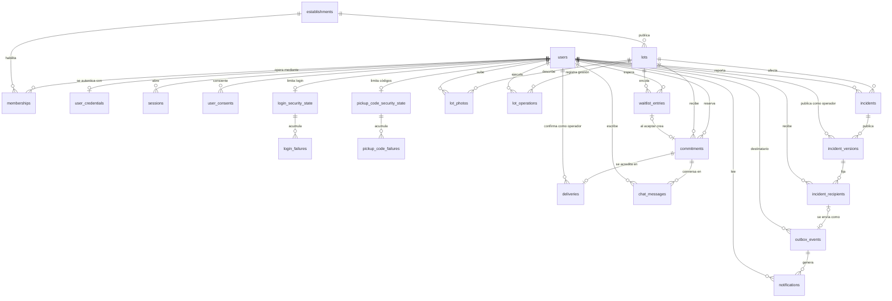
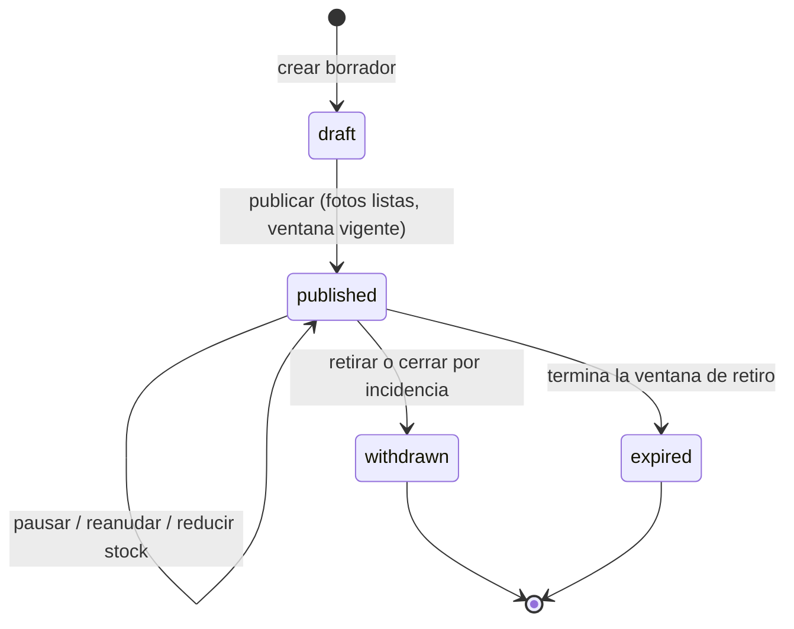
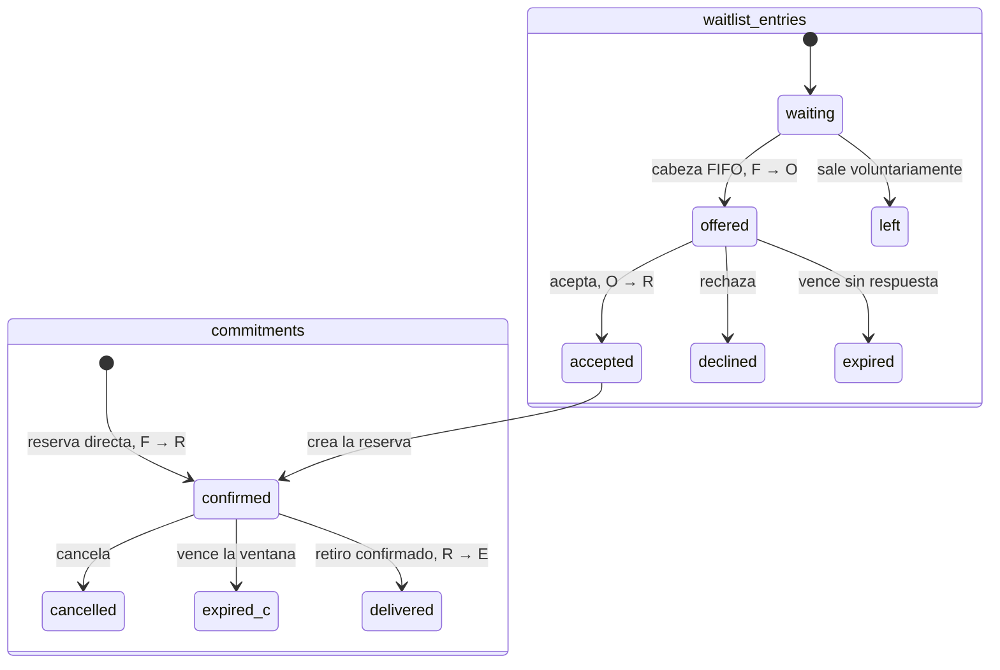

# Modelo de datos de Rescate

Este documento describe el esquema que dejan las [migraciones](../api/migrations) y
los estados que recorre cada entidad. Las reglas de cada operación están en el
documento de su área; las columnas exactas, en el SQL. Los requisitos vienen del
[informe E1](entregas/e1/informe-e1.pdf) y sus [anexos](entregas/e1/anexos-e1.pdf)
(A p. 1, B p. 4, F p. 8, H pp. 20–22, I pp. 24–27), con las precisiones de los ADR.

## Vocabulario

- **Usuario:** persona con cuenta. Rescata lotes y, mediante una **membresía**,
  opera uno o más establecimientos. «Operador» no es otro tipo de cuenta ni un rol
  global: es el usuario cuando actúa por un establecimiento del que es miembro.
- **Lote:** oferta de un establecimiento con descripción, lugar y ventana de retiro.
  Contiene `Q` packs equivalentes e indivisibles; toda cantidad se mide en packs.
- **Solicitud en espera:** pedido FIFO cuando no alcanza el inventario o ya hay
  personas esperando. Puede recibir una **oferta**, a veces parcial
  ([ADR 0002](adr/0002-ofertas-parciales.md)).
- **Reserva** (`commitments`): cantidad confirmada de un usuario en un lote, por
  reserva directa o al aceptar una oferta. Tiene un código de retiro mientras está
  vigente.
- **Entrega:** hecho histórico de que una reserva se retiró completa; mueve `R → E`.
- **Incidencia:** problema reportado sobre un lote, antes o después de entregar. Se
  comunica por versiones publicadas y nunca deshace una entrega.

## Diagrama entidad-relación

`worker_heartbeat` (una fila con el último ciclo exitoso) y `pgmigrations` (historial
de node-pg-migrate) no se relacionan con el resto. `migration_tool_test` es la tabla
de prueba de [ADR 0001](adr/0001-gestor-de-migraciones.md) y no se usa.

## Tablas por área

| Área | Tabla | Qué guarda | Unicidad y reglas clave | Documento |
| --- | --- | --- | --- | --- |
| Identidad | `users` | Correo canónico (recortado y en minúsculas) y `public_id`. | Correo canónico único. | [identidad](k008-identidad.md) |
| | `user_credentials` | Hash scrypt, sal y parámetros. | Una por usuario. | [identidad](k008-identidad.md) |
| | `sessions` | Hash del token, vencimiento y revocación. | Hash único; el token nunca se guarda. | [identidad](k008-identidad.md) |
| | `user_consents` | Consentimiento del correo con versión de política, otorgado y revocado. | Uno vigente por usuario y propósito. | [ADR 0009](adr/0009-consentimiento-del-correo.md) |
| | `login_security_state`, `login_failures` | Fallos de login y bloqueo vigente. | — | [seguridad](seguridad.md) |
| Establecimientos | `establishments` | Nombre, dirección, coordenadas, zona horaria y `public_id`. | — | [panel](panel.md) |
| | `memberships` | Pertenencia de un usuario a un establecimiento. | Un par usuario–establecimiento. Sin roles. | [identidad](k008-identidad.md) |
| Lotes | `lots` | Contenido, instantánea de lugar y zona, ventana, estado, versión, inventario O/R/E/X y F generado, pausa, cierre y reclamo de vencimiento. | `Q = F + O + R + E + X` con contadores ≥ 0; borrador ⇔ sin `published_at`; cerrado ⇔ `closed_at`; pausa solo publicado. | [lotes](lotes.md), [ADR 0006](adr/0006-inventario-del-lote.md), [ADR 0008](adr/0008-estado-del-lote-y-cierre-logico.md) |
| | `lot_operations` | Historial de reducir stock, pausar, reanudar y retirar, con motivo, versión esperada y resultado. | Una por clave idempotente del usuario. | [lotes](lotes.md#disponibilidad-después-de-publicar), [ADR 0017](adr/0017-gestion-de-publicaciones.md) |
| | `lot_photos` | Posición, estado, plazo de carga, formato, tamaño, dimensiones, rechazo y limpieza de objetos. | Una posición activa por lote; el cupo lo fija Application. | [fotos](fotos.md), [ADR 0005](adr/0005-ciclo-de-fotos.md) |
| Asignación | `commitments` | Reserva: cantidad, estado, fin, código cifrado y su huella, clave idempotente. | Una confirmada por usuario y lote; huella única; código solo si está confirmada. | [reservas](reservas.md), [ADR 0004](adr/0004-reserva-directa-idempotente.md), [ADR 0007](adr/0007-codigo-de-retiro-y-transiciones.md) |
| | `waitlist_entries` | Solicitud FIFO: cantidad pedida, oferta (cantidad, emisión, vencimiento), reserva creada al aceptar. | Una abierta por usuario y lote; FIFO por `id`; oferta ≤ pedido. | [cola de espera](cola-de-espera.md), [ADR 0010](adr/0010-cola-fifo-y-ofertas.md) |
| | `deliveries` | Entrega: operador, cantidad, instante y clave idempotente. | Una por reserva. | [reservas](reservas.md) |
| | `pickup_code_security_state`, `pickup_code_failures` | Fallos de código de retiro y suspensión por operador. | — | [ADR 0013](adr/0013-limite-de-codigos-de-retiro.md) |
| Comunicación | `chat_messages` | Mensaje de la reserva: autor, secuencia y texto, que se borra al cumplir la retención. | Secuencia única por reserva; clave idempotente por autor. | [chat](chat.md), [ADR 0016](adr/0016-chat-de-la-reserva.md) |
| | `outbox_events` | Evento de una transición para un destinatario, con estado de entrega y reintentos. | Único por tipo, sujeto, versión y destinatario. | [avisos](avisos.md), [ADR 0012](adr/0012-avisos-y-outbox.md) |
| | `notifications` | Aviso en la bandeja de un usuario y su lectura. | Uno por evento y usuario. | [avisos](avisos.md) |
| Incidencias | `incidents` | Reporte con motivo, estado y versión vigente. | Clave idempotente por quien reporta. | [incidencias](incidencias.md) |
| | `incident_versions` | Versión publicada: estado, motivo, instrucciones, si cerró el lote. | Versión 1 es `open`; clave idempotente por quien publica. | [ADR 0020](adr/0020-destinatarios-de-incidencias.md), [ADR 0021](adr/0021-gestion-de-incidencias-del-operador.md) |
| | `incident_recipients` | Destinatario fijado por versión, su vínculo con el lote y el evento que lo avisó. | Una persona por incidencia y versión. | [incidencias](incidencias.md) |
| Operación | `worker_heartbeat` | Último ciclo exitoso del worker. | Una fila. | [operación](operacion.md#salud) |

### Convenciones

- Las claves internas son `bigint GENERATED ALWAYS AS IDENTITY`. La API expone solo
  `public_id` (UUID); nunca un `id` interno.
- Todas las FK son NOT NULL salvo las que nacen después (`waitlist_entries.commitment_id`,
  `incident_recipients.outbox_event_id`), sin cascadas: nada se borra en cadena.
- Los instantes son `timestamptz`. Las operaciones usan la hora de PostgreSQL leída
  bajo el bloqueo, no la del proceso.
- Las restricciones tienen nombre (`<tabla>_<regla>_check`, `_key`), para que
  Infrastructure las reconozca.
- Los comandos repetibles guardan una clave idempotente única por actor y devuelven
  el resultado ya persistido al reintentar.
- Lote y reserva se cierran de forma lógica (`closed_at`, `ended_at`); no se borran
  filas de negocio. La única eliminación de contenido es el texto del chat vencido.
- PostGIS indexa las coordenadas de los lotes publicados para la búsqueda por radio.

## Estados

### Lote

Agotado y pausado no son estados: el primero es `F = 0` y el segundo `paused_at`.
Retirar o vencer pasa todo F, O y R a X, termina reservas y ofertas, y conserva E.

### Solicitud en espera y reserva

`expired_c` es el valor `expired` de `commitments`. Rechazar o vencer una oferta
devuelve O a F si el lote sigue vigente o lo pasa a X si cerró; no hay reingreso
automático ([ADR 0002](adr/0002-ofertas-parciales.md)). Cancelar y vencer una reserva
mueven R a F o X del mismo modo. Al terminar una reserva se borra el código cifrado.

### Foto

`uploading → pending → ready | rejected`, y cualquiera `→ removed`. Solo una foto
`ready` se muestra; publicar exige que todas las activas lo estén
([fotos](fotos.md)).

### Incidencia

`reported → open → following → resolved`. Un reporte (`version = 0`) no avisa ni
cierra nada. Cada publicación crea una versión, fija sus destinatarios bajo el
bloqueo del lote y puede cerrar el lote ([incidencias](incidencias.md)).

### Evento del outbox

`pending → processed`, o `failed` tras cinco intentos. El aviso es único por
evento y destinatario, así que un reintento no lo duplica.

## Integridad que se comprueba

La restauración de una copia verifica estas mismas reglas sobre los datos
([operación](operacion.md#conciliación)): inventario, una entrega por reserva
entregada, códigos solo en reservas confirmadas, estado de la incidencia igual al de
su última versión, eventos y avisos coherentes, secuencias del chat sin huecos y una
foto por objeto. `npm --prefix api run db:test:compose` prueba las restricciones y
el historial de migraciones ([migraciones](migraciones.md)).
